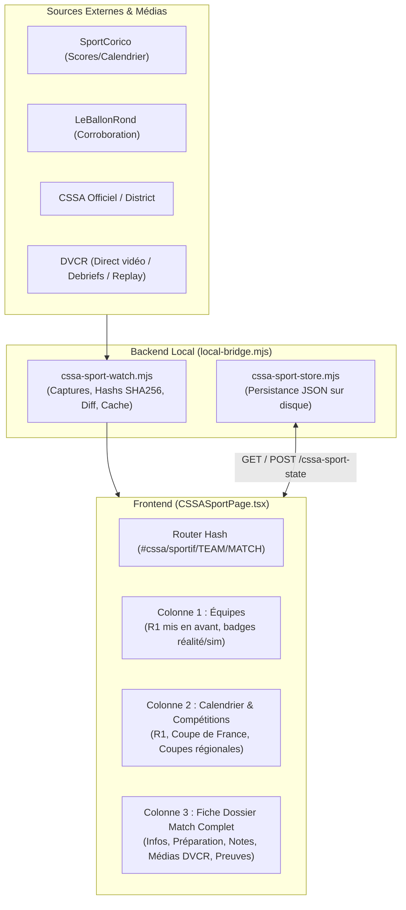

# RAPPORT MAÎTRE : AUDIT READ-ONLY & PROPOSITION TRANCHE 1 — MONDE OBSIDIA

**Date d'audit :** 13 octobre 2026  
**Dépôt audité :** `C:\Users\Aubin\Desktop\OBSIDIA_WORLDS\monde-obsidia-git`  
**Branche active :** `main` (commit `718150d`)  
**Dépôt GitHub amont :** `Eaubin08/monde-obsidia`

---

## 1. AUDIT READ-ONLY COMPLET (SECTIONS A À T)

### A. État réel actuel du produit
* **Compilation TypeScript & Build (`npm run build`) : EN ÉCHEC (FAIL)**
  * **Erreur bloquante :** `src/CSSAPage.tsx(542,10): error TS6133: 'CssaSportPage' is declared but its value is never read.`
  * **Cause :** Une fonction orpheline `CssaSportPage` a été laissée dans `src/CSSAPage.tsx` lors de l'extraction vers `src/CSSASportPage.tsx`. `tsc -b` échoue et bloque la création du bundle de production.
* **Suite de tests automatisés (`npm test`) : 69 PASS / 1 FAIL**
  * **Test en échec :** `tests/universal-c5-bridge.test.mjs:40` (`C5 route is GET only, and UI is read-only`).
  * **Cause :** Le commit `7db8d10` a retiré la balise `aria-label="Universal C5 — Organisations"` de `src/V5Root.tsx` dans la zone gouvernance, rompant l'assertion de non-régression du test.
* **Maturité globale :**
  * L'application a accumulé de nombreuses maquettes et panneaux descriptifs ("voici ce que le système sait faire" ou "ce que le test prouve"), mais presque aucun parcours métier n'est utilisable de bout en bout avec actions, saisie, persistance et preuves réelles.
  * Le prototype de **CSSA Sportif** existe dans `src/CSSASportPage.tsx`, mais il est limité : stockage volatile en `localStorage`, DVCR absent, équipes hors R1 générées par pure simulation F3E, et dossier match superficiel.

---

### B. Architecture frontend actuelle
* **Stack technique :** React 19.2.8, TypeScript ~6.0.2, Vite 8.3.0.
* **Point d'entrée :** `src/main.tsx` montant `src/V5Root.tsx`.
* **Composants clés :**
  * `V5Root.tsx` (792 lignes, 67 Ko) : Hub central gérant la navigation globale (`world`, `workspace`, `agents`, `search`, `cssa`), le polling de l'état local (`/obsidia-local/state`, `/snapshot`, `/processes`), et le rendu des Territoires Monde.
  * `V5Pokemon.tsx` / `LivePokemon.tsx` : Moteur Agent Town (MIT commit 78e8e91) représentant les agents observés (Obsidure, Brody), avec séparation stricte entre les 52 agents documentés et les sessions live réelles.
  * `V5Launchers.tsx` : Lancement natif de fenêtres PowerShell Windows pour Brody, Obsidure et le CLI Obsidia.
  * `CSSAPage.tsx` (853 lignes, 100 Ko) : Hub des structures (`cssa`, `trading`, `gps`), avec un tableau de bord sémantique et un catalogue d'objets métier génériques.
  * `CSSASportPage.tsx` (179 lignes, 17 Ko) : Cockpit sportif 3 colonnes (Équipes, Calendrier/Résultats, Détail/Préparation).

---

### C. Routes et pages existantes
Le routage repose sur un écouteur d'événement `hashchange` sans routeur structuré :
* `#world` : Vue d'ensemble du Monde, découpée en 8 zones internes (`home`, `territories`, `activity`, `rnd`, `agents`, `governance`, `knowledge`, `domains`, `layers`).
* `#workspace` : Espace de travail des processus (`home`, `launchers`, `brody`, `obsidure`, `cli`, `files`).
* `#agents` : Pokémon View (Agent Town).
* `#search` : Moteur de recherche transversal.
* `#cssa` : Entrée cockpit organisations.
  * Sous-hachage partiel : `#cssa/:module/:id`.
  * **Absence de routage profond :** Impossible de lier ou recharger directement `#cssa/sportif/SENIORS_R1/match/r1-j7`. Le bouton "Précédent" du navigateur quitte la page CSSA au lieu de fermer un match ou remonter dans l'arborescence.

---

### D. Backends et endpoints locaux
Pont local Node.js `server/local-bridge.mjs` (port 5180 ou middleware Vite `/obsidia-local/*`) :
* `GET /obsidia-local/state` : État unifié déterministe (sessions, entités, relations, missions).
* `GET /obsidia-local/snapshot` : État Git du dépôt Obsidia amont (branches, worktrees, proposals).
* `GET /obsidia-local/processes` : Processus actifs surveillés (PID, statut, sortie console).
* `POST /obsidia-local/run` : Lancement d'un outil local (Obsidure, Brody, CLI, audit dry-run).
* `POST /obsidia-local/input/:id` : Transmission stdin vers un processus.
* `POST /obsidia-local/stop/:id` : Arrêt gracieux / terminaison de processus.
* `POST /obsidia-local/focus/:id` : Remise au premier plan Windows du terminal PowerShell associé.
* `GET /obsidia-local/cssa-sport-watch` : Données de veille sportive (`server/cssa-sport-watch.mjs`).
* `GET /obsidia-local/native-enterprise` : Projection du modèle de lecture natif multi-dépôts.
* `GET /obsidia-local/universal-c5*` : Projections de gouvernance C5 / C5.3 / C5.4 / C5.5 (KX108 readonly).
* `GET /obsidia-local/services` : Surveillance de l'API locale Brody (port 8000).

---

### E. Sources de données
1. **Fichiers publics intégrés :**
   * `public/data/local-inventory.json` : Commit et fichiers du dépôt source.
   * `public/data/obsidia-layers.json` : Cartographie des couches documentaires.
   * `public/data/rd-registry.json` : Registre des 52 agents historiques.
2. **Modèle de référence CSSA local (`obsidia-cssa-readonly`) :**
   * `organizations/cssa/season/public_model_v0.json` : Données réelles 2026-2027 (19 équipes, 14 clubs R1 A, 12 clubs R2 A, grille tarifaire des licences, SIRENs).
   * `organizations/cssa/watch/watchlist_v0.json` : Liste officielle des 14 URLs surveillées.
3. **Veille web active (`server/cssa-sport-watch.mjs`) :**
   * SportCorico (calendrier/scores Seniors 1).
   * LeBallonRond (corroboration R1).
   * Site officiel CS Sedan Ardennes (`https://cs-sedan.fr/`).
   * District des Ardennes FFF.
   * **DVCR (`https://www.dvcr.fr/`) :** Accessible et actif (diffusions YouTube Jour de match, blog d'avant-match et débriefs, podcasts), mais **non connecté** à la veille actuelle.

---

### F. Repositories externes identifiés sur la machine
Tous les dépôts sont présents dans `C:\Users\Aubin\Desktop\OBSIDIA_WORLDS\` :
* **CSSA :** `obsidia-cssa-readonly` (`Eaubin08/cssa-v01--entreprise-universelle-domaien-obsidia-`, branche `feat/f3h-h-cssa-real-readonly-pilot-preflight-v0`).
* **Trading :** `obsidia-trading-c41` (`Eaubin08/OBSIDIA_TRADING`).
* **GPS / Défense :** `obsidia-gps-c41` (`Eaubin08/obsidia-gps-defense-`).
* **Obsidia Core :** `sources/obsidia-x108-proofs` (`Eaubin08/obsidia-x108-proofs`).

---

### G. Données réellement disponibles (Seniors R1 & CSSA)
* **Calendrier & Résultats R1 A 2026–2027 :** 26 journées réelles (dates, horaires, adversaires, scores réels J1 à J6, domicile/extérieur).
* **Coupe de France 2026–2027 :** 3 matchs réels constatés (Haybes 1–3 Sedan, Sedan 5–0 Christo, Hagondange 0–2 Sedan au 11 octobre 2026).
* **Conflit documenté J7 :** Match contre Bogny FC avec discordances d'horaires/dates entre sources (SportCorico vs LeBallonRond).
* **Équipes du club :** 19 structures sportives publiques identifiées (Seniors R1, R2, U20, U17, U16, U15 R1, U15 D1, Féminines, École de foot).
* **Entités légales :** SIREN Association (780287843), SAS (798016796), DVCR (923996078), Ardennes Club Partners (939505657).
* **Tarifs & Licences :** Tarifs officiels des packs licences CSSA (180 € / 240 € / 300 €), réductions (famille, féminine, Pass Sport: 70 €) et barème LGEF.

---

### H. Données simulées à isoler
* **Calendrier des 18 équipes hors R1 :** Généré par algorithme synthétique déterministe (`simulatedCalendar` / F3E) pour combler l'affichage. Ces rencontres sont étiquetées `SIMULATED_NOT_OBSERVED` mais ne correspondent pas aux calendriers réels de ces équipes.
* **Corpus de stress-tests :** 15 120 profils adversariaux F3G-A, 16 scénarios buvette F3G-J, 5 fixtures de test CRM/TASKS F3H-D. Ce sont des batteries de test et non des événements de gestion du club.

---

### I. Hardcodes, fixtures et mocks
* Constante `R1_REAL` (26 matchs en dur dans `src/CSSASportPage.tsx`).
* Constantes `CDF` et `ARDENNES` codées en dur.
* Liste statique `TEAMS` (19 équipes en dur).
* Parser regex de SportCorico dans `server/cssa-sport-watch.mjs`, vulnérable aux variations textuelles.
* Dictionnaires de profils et capacités sémantiques dans `src/CSSAPage.tsx`.

---

### J. Boutons inopérants ou quasi-inopérants
* **Dans `CSSAPage.tsx` :**
  * Sélecteurs de modules (Académie, Commercial, Bénévoles, Partenaires, Finance, Administration, Mail, Reporting) : affichent une même liste statique sans action possible.
  * Champ "Nom du projet local" + bouton `+ Ajouter` : stocke un objet dans un `useState` React en mémoire qui disparaît dès qu'on change de vue ou recharge la page.
  * Boutons de relations sémantiques (`openModule`) : basculent seulement l'onglet actif.
* **Dans `CSSASportPage.tsx` :**
  * Checklists de préparation : cases à cocher déconnectées de vraies tâches ou intervenants.
  * Bouton "Marquer comme revu" : alterne un booléen dans `localStorage`.

---

### K. Pages non fonctionnelles
* **Organisation CSSA :** Aucun organigramme hiérarchique interactif (pôles, fiches de poste, personnes rattachées avec dates et sources).
* **Matchday :** Aucun vrai plan d'organisation de rencontre (stade Louis-Dugauguez, sécurité, billetterie, volontaires, accueil arbitres).
* **CRM & Tâches :** N'expose que des fixtures de test sans formulaire de création, d'assignation ou de suivi de dossiers réels.
* **Trading & GPS :** Même template d'inspection passif que le CSSA ; aucun parcours de passage d'ordre Paper (Trading) ni d'analyse d'incident capteur (GPS).

---

### L. Problèmes de persistance
* **Tout l'état de travail Sportif est actuellement stocké dans le `localStorage` du navigateur :**
  * `cssa:sport:team` (équipe sélectionnée)
  * `cssa:sport:notes` (notes de match rédigées)
  * `cssa:sport:reviewed` (statut de revue du match)
  * `cssa:sport:checks` (cases cochées de la préparation)
* **Impact :** Perte irrémédiable de données en navigation privée, lors du nettoyage du cache ou en changeant de poste. Aucune API locale ne persiste l'état métier sur disque.

---

### M. Problèmes de routing
* Absence d'URL persistante par match : recharger la page (`F5`) réinitialise la sélection sur le premier match disponible.
* Le bouton "Précédent" du navigateur ne permet pas de revenir en arrière dans les matchs ou entre les équipes.

---

### N. Problèmes de mise à jour automatique
* Le serveur de veille `server/cssa-sport-watch.mjs` maintient l'historique des hashs en mémoire RAM (`previousHashes = new Map()`). Un redémarrage du serveur réinitialise tout en `BASELINE`.
* Aucun stockage sur disque des captures, des diffs de contenu ou des horodatages réels.
* DVCR n'est pas intégré à la boucle de veille.

---

### O. Problèmes UX
* Surcharge d'éléments techniques (`KX108_ONLY`, `DomainStateRef`, contrats d'adapters) au détriment de l'information métier (adversaire, enjeu sportif, logistique terrain, couverture vidéo).
* Fiche match compactée dans un panneau latéral sans onglets clairs pour séparer logistique, arbitrage, notes de staff et couverture médiatique.
* Présentation uniforme des équipes dans la barre latérale sans mise en évidence du statut réel (Seniors R1) par rapport aux équipes en simulation F3E.

---

### P. Duplication et dette technique
* `src/CSSAPage.tsx` contient l'ancien composant `CssaSportPage` inutilisé (lignes 542 à 608), provoquant l'échec de compilation TypeScript.
* Types et constantes de matchs dupliqués (`r1Static` vs `R1_REAL`, `coupeFrance` vs `CDF`, `ardennesCups` vs `ARDENNES`).

---

### Q. Risques de régression
* `src/V5Root.tsx` est le pivot de l'application : toute modification non maîtrisée risque de casser les tests de synchronisation d'état et de lanceurs Windows.
* Le test `tests/universal-c5-bridge.test.mjs` exige la présence du panneau gouvernance `Universal C5 — Organisations` en mode strict `GET` sans mutation.

---

### R. Proposition de première tranche
* **Périmètre strict :** **CSSA Sportif / Seniors R1**.
* Rendre la gestion de l'équipe fanion (Seniors R1) **100% utilisable, persistante et connectée aux sources réelles**, avec dossier de match complet, couverture média DVCR, gestion des conflits, persistance serveur sur disque et routage profond.

---

### S. Fichiers exacts à modifier
1. `src/CSSAPage.tsx` : Supprimer la fonction morte `CssaSportPage` et ses imports inutilisés pour rétablir la compilation TypeScript.
2. `src/V5Root.tsx` : Rétablir le panneau attendu par `tests/universal-c5-bridge.test.mjs` pour obtenir 100% de tests au vert.
3. `src/CSSASportPage.tsx` : Refonte du cockpit Sportif R1 avec routage profond, dossier match complet, médias DVCR et synchronisation serveur.
4. `src/CSSASport.css` : Enrichissement ergonomique de la fiche match et des blocs médias.
5. `server/cssa-sport-watch.mjs` : Ajout de DVCR dans la veille, capture des flux et fiabilisation de la détection de changements.
6. `server/cssa-sport-store.mjs` *(nouveau)* : Moteur de persistance local sur disque (JSON) pour les notes, checklists de préparation, revues et tâches de match.
7. `server/local-bridge.mjs` : Exposer les routes `/obsidia-local/cssa-sport-state` (GET/POST).
8. `tests/cssa-sport.test.mjs` *(nouveau)* : Tests d'intégration automatisés du cycle complet Sportif R1.

---

### T. Tests exacts à exécuter pour valider la tranche
1. `npm.cmd test` : Vérifier que les 70 tests passent avec **0 échec**.
2. `npm.cmd run build` : Vérifier que `tsc -b && vite build` s'exécute avec **0 erreur**.
3. `node --test tests/cssa-sport.test.mjs` : Vérifier la persistance des notes, des checklists, des statuts et la résilience aux sources.
4. **Vérification manuelle en condition réelle :**
   * Lancement via `./DEMARRER.cmd`
   * Navigation vers `CSSA > Sportif > Seniors R1`
   * Ouverture d'un match (ex. `Bogny FC - CSSA` du 17 oct.)
   * Cocher des points de préparation, saisir une note de match, marquer comme revu
   * Rafraîchissement complet (`F5`) et réouverture directe par URL `#cssa/sportif/SENIORS_R1/r1-j7` : confirmation que tout le travail persiste.

---

## 2. SPÉCIFICATION DE LA TRANCHE 1 — CSSA SPORTIF / SENIORS R1

### Parcours utilisateur cible :
1. **Accès :** Clic sur "CSSA", puis onglet "Sportif".
2. **Choix de l'équipe :** Sélection immédiate de **Seniors R1** (distinction visuelle nette avec les équipes sim F3E).
3. **Sélection de la compétition / filtre :** Tout, Régional 1 (26 j.), Coupe de France (3 tours passés), À venir, Résultats.
4. **Ouverture d'un match (ex. Bogny FC — CSSA du 17 oct. 2026) :**
   * L'URL devient `#cssa/sportif/SENIORS_R1/r1-j7`.
   * Affichage de la fiche dossier match complète à droite :
     * **Statut & Vérité :** Signalement du conflit d'horaires/dates entre sources (`PUBLIC_CONFLICT_REVIEW`).
     * **Médias & Couverture DVCR :** Détection des contenus DVCR liés (diffusion live YouTube prévue, articles d'avant-match, débriefs).
     * **Préparation du match :** Checklist opérationnelle (Transport minibus/bus, Stade & vestiaires, Arbitrage & FMI, Communication officielle, Bénévoles).
     * **Notes du staff :** Zone de texte libre pour consignes tactiques, logistique ou contacts.
     * **Tâches liées :** Tâches réelles rattachées à la rencontre.
5. **Persistance :** Chaque modification (note, case cochée, statut revu) est envoyée au backend et sauvegardée dans un fichier JSON sur disque (`.obsidia-live/cssa_sport_state.json`).
6. **Résilience :** En rechargeant la page (`F5`) ou en rouvrant l'URL ultérieurement, la fiche match et l'ensemble des données de travail sont intégralement restaurés.
